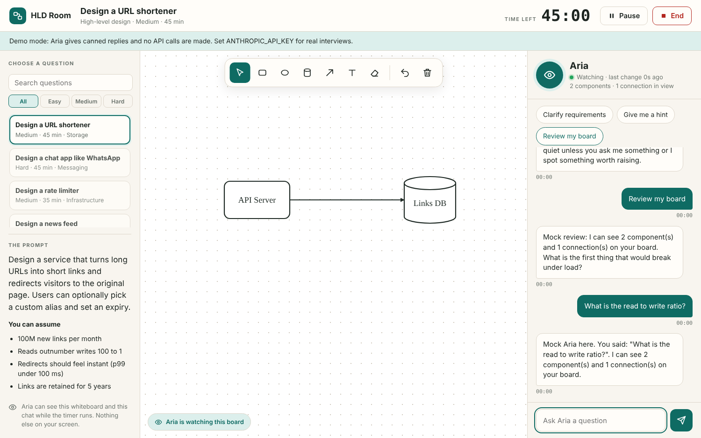
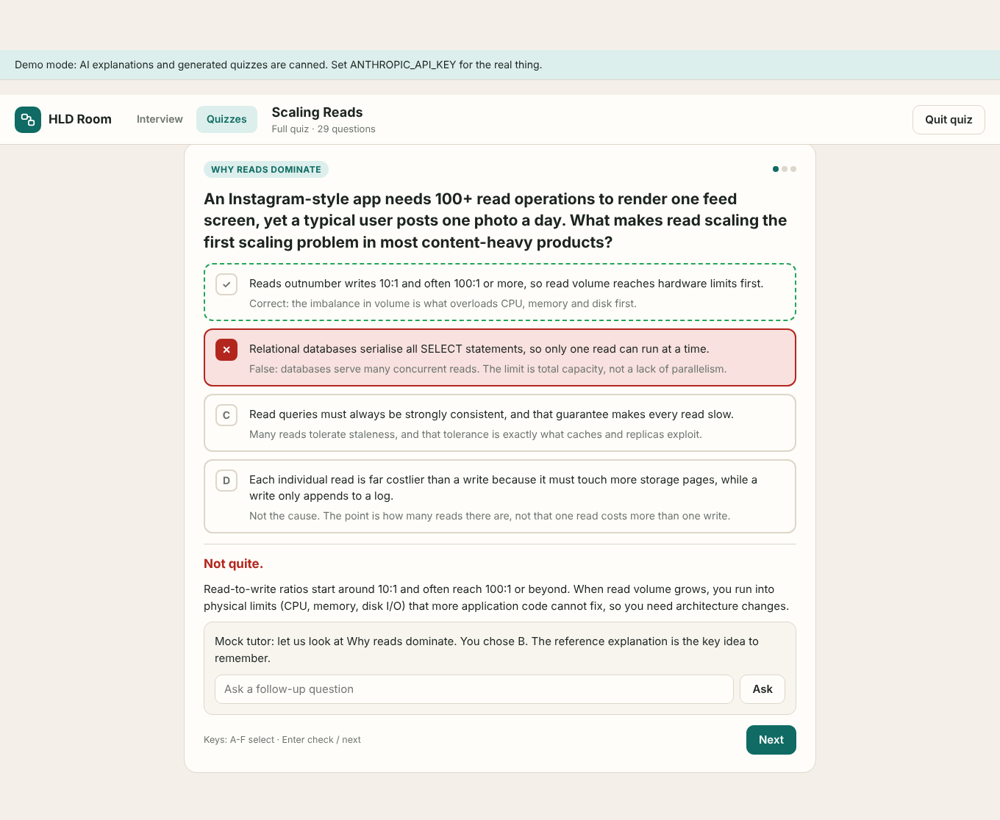

# HLD Room

Practise **high-level system design interviews** on a whiteboard, with a real AI interviewer.

You pick (or write) a question, press **Start**, and sketch your design while **Aria** (powered by Claude) watches the board and the
chat. Ask her to clarify requirements, ask for a hint, or have her review your board. She stays quiet unless you talk to her
or she spots something worth raising. When time is up she writes a scored feedback report.



## Quick start

Requirements: **Node.js 20+** and an **Anthropic API key** (https://console.anthropic.com/).

```bash
cd hld
npm install
cp .env.example .env        # then put your key in .env:  ANTHROPIC_API_KEY=sk-ant-...
npm run check               # optional: two tiny real API calls to confirm the key and model work
npm start                   # open the URL it prints (http://127.0.0.1:3000)
```

No key yet? `npm run demo` starts the same app in **demo mode** with canned replies and no API calls, which is handy for
trying the whiteboard, timer and layout.

> **Your key stays on the server.** It is read from `hld/.env` (git-ignored) or the `ANTHROPIC_API_KEY` environment
> variable. The browser never sees it, and the server only listens on `127.0.0.1` unless you change `HLD_HOST`.

## Quizzes

The **Quizzes** tab (`/quiz.html`) is for checking what you know between interviews.

- **Scaling Reads** ships with the app: 29 questions (single choice, select-all, true/false) covering indexing, denormalisation,
  read replicas, sharding, caching, invalidation, CDNs, hot keys and stampedes, and interview judgement.
- **Modes:** full quiz, **Quick 10** (a random ten), and **Retry missed** (only what you got wrong last time). A toggle switches between
  feedback after every question and exam style with everything revealed at the end.
- **Every option explains itself** once you have answered, and a summary shows your score by concept, weakest first, with a review
  of each answer. Options are shuffled each attempt.
- **Explain more with Claude** opens a tutor on any question: it explains why the right answer is right and why your pick was
  tempting, and you can ask follow-ups.
- **Create a quiz with AI:** give a topic, or paste your own study notes, choose the length and level, and Claude writes a quiz
  (validated against the same quality rules). Generated quizzes are saved in your browser and can be deleted.



Your scores and generated quizzes live in the browser (localStorage). To add a quiz to the bundled set see
[quizzes/AUTHORING.md](quizzes/AUTHORING.md).

## The three pieces

HLD Room is built from three independent parts, and each works without the others.

| Page | What it is | Needs |
|---|---|---|
| **Home** (`/`) | Pick one of 26 questions, write your own, or open a blank whiteboard. Shows sessions you can continue. | the question bank (`/api/questions`) |
| **Interview room** (`/room.html?q=<id>` or `?custom=<id>`) | A closable question panel, the whiteboard, and a closable Aria panel, plus the timer and feedback report. | only the **question** |
| **Whiteboard** (`/board.html`) | A full-page, Excalidraw-style whiteboard that saves in your browser. | nothing: no question, no timer, no bot, **no server API call at all** |

### Home

- **Pick a question:** search, difficulty and category filters. Clicking a card opens a short dialog with the prompt and assumptions, where you
  choose the candidate level (junior, mid, senior, staff), the interviewer style (supportive, balanced, tough) and a time limit, then **Start interview**.
- **Write your own:** title, description, assumptions (one per line), time limit (15/30/45/60/90 or custom), level, style and optional focus areas.
  Saved questions appear under "Your questions" (stored in this browser, newest first, at most 30) and can be edited or deleted.
- **Continue** lists interviews you paused or finished, with the time left.
- If the AI is not connected a notice says so; the whiteboard and timer still work.

### The interview room

| Do this | What happens |
|---|---|
| Read the question panel (left) | Only the question: title, prompt, assumptions, level, style, focus. Close it with the x and reopen it with the slim **Question** tab. |
| **Start** | The timer runs and Aria starts watching. Pause, resume or **End** at any time. |
| Draw on the whiteboard (middle) | The same whiteboard as `/board.html`, saved per question. |
| **Clarify requirements** | Aria answers like a product owner, and keeps every answer consistent for the rest of the interview. |
| **Give me a hint** | One graduated hint, only as strong as needed. |
| **Review my board** | Strengths, the biggest gap, and a probing question about your actual components. |
| Ask anything in the chat | Free conversation, with your board and the clock attached. |
| Close the Aria panel (right) | Aria is **completely off**: no check-ins and no AI requests. The whiteboard keeps working; reopen her with the slim **Aria** tab. Both panel states are remembered. |
| **End** (or time runs out) | A feedback report: verdict, 0-5 scores for requirements, estimation, API, data model, architecture, scaling and trade-offs, plus strengths, gaps and next steps, scaled to the level you chose. |

### The whiteboard

`public/wb/` is a standalone, dependency-free whiteboard component modelled on Excalidraw (with a system-design shape library). Hand-drawn shapes, arrows
that bind and follow, frames, text, images, freehand, laser, grid and snapping, undo/redo, groups, align/distribute, a command palette (`Ctrl/Cmd+/`),
find on canvas, export to PNG/SVG, save/open `.hld.json`, import/export `.excalidraw`, light and dark themes, zen and view modes. The full feature list is in
[docs/WHITEBOARD_API.md](docs/WHITEBOARD_API.md) (section 9) and the module contracts in the rest of that document. Press `?` in the whiteboard for every shortcut.

It is mounted with one call, `mountWhiteboard(element, { storageKey })`, and a test (`test/standalone.test.js`) enforces that nothing under `public/wb/` or `shared/`
mentions the server API, `fetch`, questions or the AI.

## How Aria works

**Aria is given only the question.** The browser sends `question: { title, prompt, assumptions, minutes, level, style, focus }` with every AI request
(`/api/chat`, `/api/watch`, `/api/evaluate`); the server validates it (`server/question.js`) and never looks anything up. There is no hidden rubric,
fact sheet or follow-up list: Aria uses her own senior expertise, treats her answers to requirement questions as facts she must keep consistent, calibrates
how deep to push to the **level**, adapts her tone to the **style**, and gently steers toward the **focus** when you set one.

Aria does not receive a screenshot. Each request carries a **text description of the board** (components, what connects to what, arrows with a loose end,
components with no arrows, your notes; images and freehand strokes are only counted) plus the chat and the time used. Quiet check-ins happen only while the timer
runs and her panel is open: after you stop editing for a few seconds the server asks the model whether anything is worth saying, and the model usually answers "no".
Unprompted remarks are rate limited (at most one every 75 seconds, ten per interview).

## Configuration

Set in `hld/.env` or the environment.

| Variable | Default | Meaning |
|---|---|---|
| `ANTHROPIC_API_KEY` | - | Your key. Required for the real AI. |
| `HLD_MODEL` | `claude-sonnet-5-5` | Default model Aria uses. Anyone using the page can pick Sonnet, Opus, Haiku or Fable from the key button (top right); that choice is saved in the browser. For the strongest answers try `claude-opus-5-5`; for the cheapest try `claude-haiku-5-5`. |
| `HLD_EFFORT` | `default` | `default` = low effort for chat and check-ins, high for the final report. Or `low`/`medium`/`high`/`xhigh`/`max` for everything, or `none` to send no effort setting (needed for older models that do not support it). |
| `PORT` | `3000` | Port to listen on. |
| `HLD_HOST` | `127.0.0.1` | Bind address. Only change it if you understand that anyone who can reach the port can spend your key. |
| `HLD_MOCK` | - | `1` = demo mode (same as `npm run demo`). |

A session makes a handful of small streaming requests plus one larger request for the report. Cost depends on the model you
choose; the question block is cached between requests.

## Project layout

```
hld/
  server/        index.js (HTTP + SSE API), question.js (validates the question the client sends), ai.js (Claude calls), prompts.js (Aria's instructions),
                 quiz.js, mock.js, env.js, check.js
  shared/        board.js + wbconst.js (board model, text description for the AI), quiz.js (quiz model); used by browser and server
  public/        index.html + home.js + home.css (Home), room.html + room.js + room.css (interview room), board.html + board.js (whiteboard page),
                 store.js (localStorage helpers), quiz.html + quiz.js, styles.css (shared header and tokens)
  public/wb/     the standalone whiteboard component (mount.js assembles it)
  questions/     questions.json - the question bank (26 questions: id, title, category, difficulty, minutes, prompt, assumptions)
  quizzes/       the bundled quizzes (JSON) and AUTHORING.md
  docs/          WHITEBOARD_API.md - whiteboard architecture and module contracts
  test/          unit and API tests, plus an end-to-end browser test
```

API (all JSON except the streaming endpoints, which use Server-Sent Events): `GET /api/health`, `GET /api/questions`,
`POST /api/chat` (stream), `POST /api/watch`, `POST /api/evaluate` (these three take `question` in the body; board payloads up to 768 KB),
`GET /api/quizzes`, `GET /api/quizzes/:id`, `POST /api/quiz/explain` (stream), `POST /api/quiz/generate`.

## Adding or editing questions

Edit `questions/questions.json`. Each entry has `id`, `title`, `category`, `difficulty` (`Easy`/`Medium`/`Hard`), `minutes`, `prompt` and `assumptions`, all shown
to the candidate. That is everything: the interviewer has no extra data about a question. `npm test` validates every entry. You can also write questions in the
browser from the Home page; they live in your browser's localStorage and are sent to the server with each request, like bank questions.

## Tests

```bash
npm test        # unit + API tests (board model, whiteboard modules, question validation, prompts, Claude request shapes with a fake client, HTTP/SSE server, standalone-whiteboard check)
npm run e2e     # drives the real UI (Home, interview room, standalone whiteboard and quizzes) in headless Chromium against the demo-mode server (set HLD_CHROME if Chromium is not found)
npm run check   # live check of your API key and model (three tiny real requests; add "-- --quiz" to also generate a quiz)
```

## Troubleshooting

- **"Aria is not connected"** banner (the whiteboard and timer still work): `hld/.env` is missing or has no key. Restart the server after editing it.
- **"The Anthropic API key was rejected"**: the key is wrong, revoked, or from another workspace.
- **"The configured model was not found"** or a 400 mentioning effort: check `HLD_MODEL`; for older models set `HLD_EFFORT=none`.
- **Aria never speaks unprompted**: that is by design; ask her something or press a quick action. Use "Review my board" for feedback on demand.
- **Lost your board?** It is saved per question (and the scratch board separately) in the browser's localStorage. Clearing site data removes it. If a very large board cannot be saved, the whiteboard shows "Board too large to save in this browser"; export it to a file.
